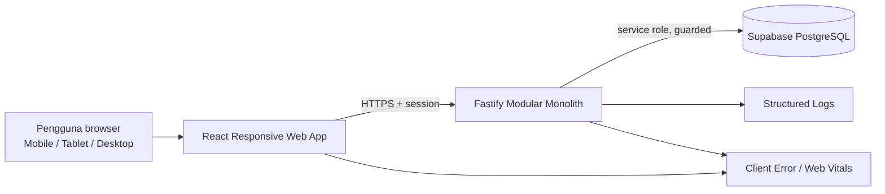

# 02 — Arsitektur Target dan Ownership

## Sasaran Arsitektur

Arsitektur target mempertahankan modular monolith dan memisahkan empat tanggung jawab:

1. **Domain** menentukan aturan bisnis dan otorisasi.
2. **Data access** menentukan contract API, query key, cache, pagination, dan mutation.
3. **Composition** menggabungkan state dan use case untuk satu layar.
4. **Presentation adapter** menentukan bagaimana data yang sama ditampilkan pada desktop, tablet, atau ponsel.

Responsivitas hanya boleh berada pada composition dan presentation. Perhitungan kas, validasi peminjaman, RBAC, audit, dan idempotency tidak boleh bercabang berdasarkan viewport.

## Prinsip Keputusan

- **Satu domain state, beberapa presentasi.** Desktop table dan mobile cards membaca query result dan action handler yang sama.
- **Satu adapter aktif.** Jangan me-render tabel dan cards bersamaan lalu hanya menyembunyikan salah satunya dengan CSS.
- **Page tipis.** Page mengatur route boundary dan memasang composition; business flow tidak ditulis di page.
- **Feature ownership dahulu.** Abstraksi shared dibuat setelah minimal dua fitur membuktikan bentuk yang sama.
- **Server authoritative.** Frontend boleh optimistis, tetapi tidak boleh mengarang saldo, status utang, role, atau outcome transaksi.
- **Backward-compatible API.** Contract lama dipertahankan selama fase migrasi dan dihentikan hanya dengan compatibility plan.
- **Online-first.** PWA, offline queue, dan background sync bukan bagian arsitektur target tahap ini.

## Context Diagram



## Dependency Direction

```text
app/router
  → feature/pages
    → feature/compositions
      → feature/components
      → feature/queries + mutations
        → feature/services
          → shared/api/client

shared tidak boleh mengimpor feature.
component presentasional tidak boleh memanggil HTTP client langsung.
service tidak boleh mengelola state dialog, toast, atau viewport.
```

## Struktur Frontend Target

```text
frontend/src/
├── app/
│   ├── router/
│   └── providers/
├── layouts/
│   └── dashboard/
│       ├── DashboardShell.tsx
│       ├── DesktopSidebar.tsx
│       ├── MobileTopBar.tsx
│       ├── MobileBottomNavigation.tsx
│       └── MoreNavigationSheet.tsx
├── components/
│   ├── ui/                    # primitive shadcn/Base UI
│   ├── layout/                # page shell, header, section
│   ├── feedback/              # skeleton, error, empty, toast mapping
│   └── data-display/          # hanya pola yang sudah terbukti lintas fitur
├── features/
│   └── <feature>/
│       ├── pages/             # route boundary, idealnya < 100 baris
│       ├── compositions/      # screen/use-case orchestration
│       ├── components/
│       │   ├── DesktopTable.tsx
│       │   ├── TabletCollection.tsx
│       │   ├── MobileList.tsx
│       │   ├── MobileCard.tsx
│       │   ├── DetailSheet.tsx
│       │   └── FilterSheet.tsx
│       ├── hooks/             # UI/controller hook milik fitur
│       ├── queries/
│       ├── mutations/
│       ├── services/
│       ├── schemas/
│       ├── types/
│       └── utils/
└── shared/
    ├── api/
    ├── auth/
    ├── navigation/
    ├── responsive/
    └── utils/
```

Nama file adapter tidak wajib persis sama. Batas tanggung jawabnya yang wajib sama.

## Struktur Backend Target

Backend tetap satu proses Fastify dan satu deployment, tetapi `server.ts` dipecah secara bertahap.

```text
backend/src/
├── app/
│   ├── buildServer.ts
│   ├── plugins/
│   │   ├── auth.ts
│   │   ├── cors.ts
│   │   ├── securityHeaders.ts
│   │   ├── requestContext.ts
│   │   └── errorHandler.ts
│   └── routes.ts
├── modules/
│   └── <domain>/
│       ├── routes.ts
│       ├── schema.ts
│       ├── service.ts
│       ├── repository.ts
│       ├── mapper.ts
│       └── types.ts
├── shared/
│   ├── auth/
│   ├── audit/
│   ├── errors/
│   ├── http/
│   └── database/
└── server.ts                 # bootstrap singkat
```

Pemecahan dilakukan per domain ketika domain tersebut masuk vertical slice. Tidak ada rewrite serentak dan tidak ada perubahan deployment topology.

## Deep Modules dan Interface Seam

### 1. Navigation Policy

Satu konfigurasi menjadi sumber label, icon, path, grouping, dan permission navigasi.

```ts
type NavigationItem = {
  id: string;
  label: string;
  path: string;
  icon: React.ComponentType;
  permission: Permission;
  mobilePriority?: number;
};
```

Frontend memakai policy ini untuk pengalaman pengguna. Backend tetap memeriksa permission pada setiap endpoint.

### 2. Feature Collection Controller

Composition menghasilkan data dan action yang bebas viewport.

```ts
type CollectionController<TRecord, TFilter> = {
  records: TRecord[];
  filters: TFilter;
  page: number;
  pageSize: number;
  total: number;
  isLoading: boolean;
  isFetching: boolean;
  error: unknown;
  setFilters(next: TFilter): void;
  setPage(next: number): void;
  openDetail(record: TRecord): void;
  getActions(record: TRecord): RowAction[];
};
```

Ini kontrak konseptual, bukan instruksi membuat generic framework pada fase pertama.

### 3. Presentation Adapter

- Desktop: semantic table untuk scan dan perbandingan.
- Tablet: compact table atau dua-column cards berdasarkan densitas data.
- Mobile: list/card dengan 3–4 informasi utama, status, dan satu affordance detail.
- Detail: sheet untuk inspeksi singkat; route/full-screen untuk pekerjaan panjang.

#### Data Surface Inventory

Boundary adapter berlaku pada setiap collection, bukan hanya collection utama page.
Composition wajib menginventarisasi:

- collection utama route;
- collection pada semua tab;
- report section dan dashboard widget;
- table/list dalam dialog, sheet, dan nested detail;
- presentasi print/export.

Setiap surface diberi salah satu keputusan eksplisit:

```text
Data surface
  ├── Adaptive: desktop table + tablet compact + mobile card/list
  ├── Matrix exception: table + controlled horizontal scroll
  ├── Print/export only: tidak aktif pada layar/accessibility tree
  └── Key-value detail: bukan collection
```

Satu `isMobile` di page tidak menjamin seluruh descendant adaptif. Komponen report
yang memiliki collection sendiri wajib menerima mode presentasi atau memilih
adapter melalui boundary responsif yang konsisten.

#### Mobile Decision Density

Card mobile menampilkan maksimal empat nilai yang benar-benar diperlukan untuk
mengenali record dan mengambil keputusan. Field lain tetap tersedia melalui
detail sheet/route. Batas ini mencegah card berubah menjadi table vertikal yang
panjang dan sulit dipindai.

### 4. Query Contract

Semua list memakai bentuk stabil:

```ts
type ListParams = {
  page: number;
  pageSize: number;
  search?: string;
  sort?: string;
  direction?: 'asc' | 'desc';
  filters?: Record<string, string | number | boolean | undefined>;
};

type PaginatedResult<T> = {
  data: T[];
  page: number;
  pageSize: number;
  total: number;
  totalPages: number;
};
```

Query key harus memasukkan seluruh parameter yang memengaruhi respons. Filter yang perlu dipertahankan saat kembali dari detail disimpan di URL search params.

### 5. Mutation Contract

Mutation sensitif memiliki:

- idempotency key;
- change reason/audit context;
- disable while in flight;
- mapped public error;
- optimistic update hanya bila rollback deterministik;
- invalidation spesifik setelah server mengonfirmasi hasil.

### 6. Option Search Contract

Combobox siswa, alat, assignment, dan user tidak memuat seluruh data.

```text
GET /api/<resource>/options?q=<term>&limit=20&active=true
→ [{ id, label, secondaryLabel, disabled? }]
```

Server memberi projection minimum, batas maksimum, stable ordering, dan cancellation di client.

### 7. Mobile Interaction Primitives

Touch geometry dan scroll behavior merupakan deep seam. Feature tidak boleh
menambal kontrak yang sama dengan utility berbeda-beda.

Urutan ownership:

```text
components/ui
  → Button / Input / Select / Tabs / Dialog / Sheet
components/common
  → Pagination dan pola lintas feature yang sudah terbukti
features/<feature>/components
  → wording, filter model, field, dan composition domain
```

Kontrak:

- hit-area mobile minimum 44px, primary/coarse-pointer control 48px;
- dense desktop ditentukan oleh ruang dan `pointer: fine`, bukan breakpoint saja;
- field mobile full-width dan `min-width: 0`;
- page/overlay mempunyai satu pemilik scroll vertikal;
- sticky action menghormati bottom navigation, safe-area, dan keyboard;
- shared abstraction baru tetap menunggu minimal dua consumer nyata.

Spesifikasi ukuran, tabs, filters, forms, scroll, dan QA berada pada
[dokumen 10](./10-mobile-reachability-and-control-spec.md).

## State Ownership

| State | Pemilik | Persistensi |
|---|---|---|
| session user | auth store/query | memory + secure cookie server-side |
| server records | TanStack Query | query cache |
| filter shareable | URL search params | browser history |
| pagination lokal | URL atau composition | route lifecycle |
| modal/sheet open | feature composition | tidak persisten |
| form draft | React Hook Form | lifecycle form |
| toast | feedback provider | sementara |
| role/permission truth | backend | database/session claims |
| viewport | responsive hook/CSS | runtime, tidak dipersist |

Tidak boleh menyimpan salinan server records di Zustand hanya untuk menghindari prop drilling.

## Rendering Responsif

### Breakpoint operasional

| Mode | Rentang awal | Tujuan |
|---|---:|---|
| Mobile | `< 768px` | satu tangan, card/list, sheet/full-screen |
| Tablet | `768–1023px` | compact table atau dua kolom |
| Desktop | `≥ 1024px` | sidebar, semantic table, multi-column workspace |

Breakpoint boleh disesuaikan berdasarkan kebutuhan konten, bukan berdasarkan nama perangkat. Mobile adapter memakai `matchMedia` dengan cleanup; layout internal tetap memakai CSS responsive utilities.

Breakpoint hanya menentukan presentasi/layout. Ia tidak boleh otomatis
mengecilkan hit-area pada perangkat sentuh berlayar lebar. Variant compact harus
mempertimbangkan `pointer: fine`; pada `pointer: coarse`, kontrol penting tetap
memakai target mobile.

### Larangan

- tabel dan card tidak boleh aktif bersamaan;
- jangan memakai `window.innerWidth` tanpa subscription;
- jangan membuat event listener per row;
- jangan memindahkan business rule ke `if (isMobile)`;
- jangan menyembunyikan field kritis tanpa akses di detail;
- jangan mengandalkan hover sebagai satu-satunya cara menemukan action.

## Route dan Navigation Lifecycle

1. Route membuka page tipis.
2. Page memasang composition dan permission boundary presentasional.
3. Composition membaca URL filter dan query.
4. Adapter aktif menampilkan collection.
5. Detail membuka sheet/route tanpa membuang filter, page, dan posisi scroll.
6. Mutation sukses memperbarui cache/invalidate target.
7. Ketika kembali, list tetap pada konteks semula.

## Reliability dan Error Boundary

- Root error boundary menangani crash aplikasi.
- Route boundary menangani gagal lazy load.
- Section error menangani widget/report yang gagal tanpa merusak seluruh page.
- Query error menampilkan aksi retry dan correlation ID bila tersedia.
- Mutation error mempertahankan input form.
- Empty state membedakan “belum ada data” dan “filter tidak menemukan hasil”.

## Performance Budget Awal

Baseline aktual diambil sebelum coding. Target awal yang divalidasi pada perangkat kelas menengah dan jaringan throttled:

| Metrik | Target awal |
|---|---:|
| LCP p75 | ≤ 2.5 detik |
| INP p75 | ≤ 200 ms |
| CLS p75 | ≤ 0.1 |
| initial route JS gzip | tidak naik > 10% dari baseline tanpa ADR |
| list payload | projection minimum, default 10–20 record |
| mobile option results | maksimum 20–50 item per request |
| touch response | feedback terlihat < 100 ms |

## Keputusan PWA

Selama program responsive web app:

- service worker tidak aktif;
- cache clearing hack di HTML dihapus bersamaan dengan penonaktifan plugin PWA secara eksplisit;
- tidak ada offline mutation;
- manifest/install prompt/push ditunda;
- readiness PWA hanya dievaluasi setelah auth, responsive UX, observability, dan E2E stabil.

## ADR yang Wajib Dibuat Saat Implementasi

1. ADR secure cookie dan CSRF strategy.
2. ADR permission/capability model.
3. ADR adaptive collection setelah slice Siswa dan Kas selesai.
4. ADR filter state di URL.
5. ADR error contract dan correlation ID.
6. ADR PWA activation jika program PWA dimulai.
