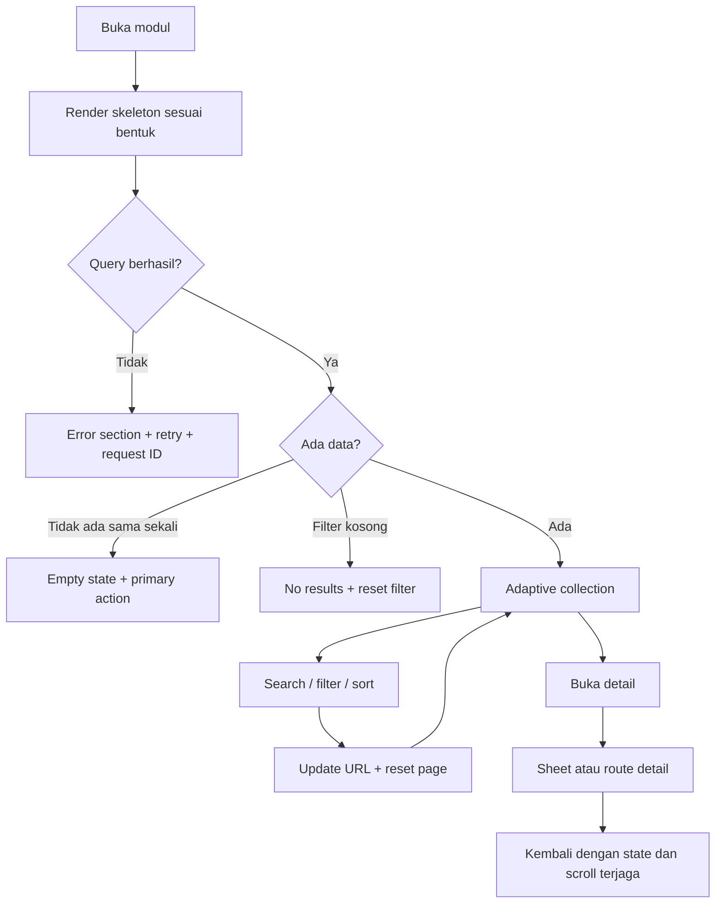
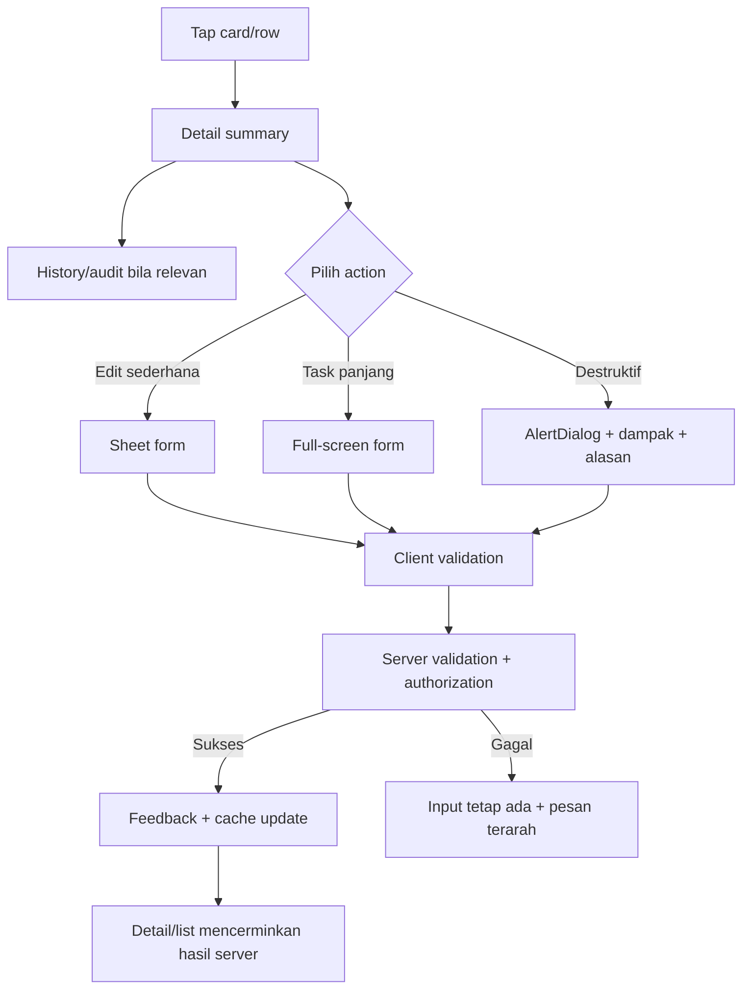

# 03 — UX Responsif dan Alur Navigasi

## Outcome Pengguna

Pengguna harus dapat melakukan tugas utama melalui ponsel tanpa memahami versi desktop dan tanpa kehilangan detail penting. Ukuran keberhasilan:

- tujuan utama suatu role dapat dicapai dalam maksimal tiga perpindahan layar;
- satu tugas mutasi memiliki satu primary CTA yang jelas;
- tidak ada horizontal scroll untuk collection biasa;
- filter, page, dan scroll tidak hilang setelah membuka detail atau menyimpan perubahan;
- status server dan hasil transaksi selalu terlihat;
- semua action dapat digunakan dengan sentuhan, keyboard, dan screen reader.

Ukuran kontrol, reach zone, tabs, filter sheet, full-width form, safe-area, dan
scroll ownership mengikuti spesifikasi normatif pada
[dokumen 10](./10-mobile-reachability-and-control-spec.md).

## Information Architecture

### Desktop

- sidebar tetap untuk seluruh modul yang diizinkan;
- header berisi title, context, notification, dan account;
- primary action berada di page header;
- secondary action berada pada overflow atau section action.

### Mobile

- top bar: back/context title, notification, account;
- bottom navigation: maksimal 3–5 tujuan frekuensi tertinggi per role;
- “Lainnya”: sheet berisi modul sekunder;
- primary create/action dapat menjadi sticky CTA di bawah konten;
- detail singkat memakai sheet, pekerjaan panjang memakai full-screen route.

Bottom navigation tidak mengubah permission. Ia hanya mengurutkan tujuan yang sudah diizinkan backend dan policy frontend.

## Prioritas Navigasi per Role

Konfigurasi final harus diverifikasi dengan PRD dan user testing.

| Role | Tujuan mobile utama | Menu Lainnya |
|---|---|---|
| Guru | Dashboard, Siswa, Absensi, Nilai | Kelas, Pengguna, Audit, modul lain |
| Sekretaris | Dashboard, Siswa, Kelas, Absensi | Notifikasi, modul lain |
| Bendahara | Dashboard, Kas, Notifikasi | Siswa, Audit terkait bila diizinkan |
| Tim Alat | Dashboard, Alat, Peminjaman, Notifikasi | Siswa, modul lain |
| Ketua | Dashboard, Peminjaman, Alat, Lomba | Notifikasi, laporan lain |
| Wakil | Dashboard, Peminjaman, Lomba, Notifikasi | modul lain |
| Tim Lomba | Dashboard, Lomba, Notifikasi | modul lain |
| Anggota | Dashboard, Peminjaman, Notifikasi | profil dan modul yang diizinkan |

## Anatomi Page

```text
Mobile
┌───────────────────────────────┐
│ Top bar: back/title/actions    │
├───────────────────────────────┤
│ Summary / important alert     │
│ Search + filter chips          │
│ Collection cards               │
│ Pagination / load more         │
│ padding bottom safe area       │
├───────────────────────────────┤
│ Sticky primary action          │
│ Bottom navigation              │
└───────────────────────────────┘
```

```text
Desktop
┌─────────────┬────────────────────────────────────────┐
│ Sidebar     │ Header                                 │
│             ├────────────────────────────────────────┤
│             │ Page title                 Actions     │
│             │ Summary / filters                      │
│             │ Semantic table / workspace             │
└─────────────┴────────────────────────────────────────┘
```

## Aturan Adaptasi Data

### Gunakan table jika

- pengguna membandingkan nilai lintas banyak kolom;
- sorting per kolom penting;
- bulk selection menjadi tugas utama;
- layar memiliki ruang cukup;
- header dan cell tetap terbaca tanpa kompresi ekstrem.

### Gunakan mobile card/list jika

- pengguna mencari satu record lalu bertindak;
- hanya 3–4 field diperlukan untuk menentukan pilihan;
- detail dapat dibuka secara progresif;
- action per record lebih penting daripada perbandingan kolom.

### Collection bersarang tetap wajib adaptif

Aturan table/card berlaku juga untuk collection di dalam tab, report, widget,
dialog, sheet, dan halaman detail. Container yang stack pada mobile tidak membuat
table multi-kolom di dalamnya otomatis nyaman digunakan.

Untuk setiap collection bersarang:

1. pilih maksimal empat nilai keputusan untuk ringkasan mobile;
2. pindahkan field sekunder ke detail;
3. pertahankan filter, sort, pagination, dan action yang sama;
4. gunakan semantic table hanya pada desktop;
5. bedakan table interaktif dari table khusus print/export.

### Horizontal scroll hanya diperbolehkan untuk

- grade matrix;
- laporan perbandingan periode;
- data tabular intrinsik yang kehilangan makna jika diubah menjadi card.

Jika dipakai, berikan sticky first column, shadow/gradient affordance, label yang tetap terlihat, dan alternatif detail.

## Anatomi Mobile Card

Urutan konsisten:

1. **Identity:** nama/judul paling penting.
2. **Secondary identifier:** NIS, username, kode alat, atau tanggal.
3. **Status:** badge dengan teks dan warna.
4. **Context:** maksimal dua informasi pendukung.
5. **Action affordance:** seluruh card membuka detail atau tombol “Lihat detail”.
6. **Overflow action:** edit/approve/delete hanya bila diizinkan.

Jangan menaruh lebih dari dua tombol sejajar pada card ponsel.
Jangan mengubah setiap kolom menjadi baris label-value di card. Jika lebih dari
empat nilai diperlukan, buka detail sheet/route.

### Contoh report Kas

```text
Siswa menunggak
  → card: nama, kelas, total tunggakan, jumlah catatan
  → detail: periode dan daftar kewajiban

Rincian pemasukan/pengeluaran
  → card: tanggal, nominal, jenis/metode, siswa atau keterangan
  → detail: seluruh metadata transaksi dan audit

Aktivitas harian
  → stacked bar/list pada layar
  → semantic table terpisah untuk print/export
```

## Alur Collection Umum



## Alur Detail dan Action



## Keputusan Dialog, Sheet, dan Route

| Kebutuhan | Mobile | Desktop |
|---|---|---|
| konfirmasi singkat | AlertDialog | AlertDialog |
| filter collection | bottom sheet | popover/panel |
| detail inspeksi | bottom/full-height sheet | side sheet/dialog |
| form ≤ 5 field sederhana | sheet | dialog |
| form panjang/upload/multi-step | full-screen route | dialog besar atau route |
| matrix/bulk operation | route workspace | dialog besar atau route |

Semua form panjang memiliki sticky footer, tombol submit tunggal, cancel/back, dan peringatan unsaved changes bila draft berubah.

## Search, Filter, dan Pagination

### Search

- debounce 250–400ms untuk server search;
- minimum term hanya jika endpoint membutuhkannya;
- request sebelumnya dibatalkan;
- tombol clear terlihat;
- search tidak menghapus filter lain;
- page kembali ke 1 saat term berubah.

### Filter

- mobile: tombol Filter menampilkan sheet;
- search utama full-width; tombol Filter minimum 48px;
- filter aktif ditampilkan sebagai removable chips;
- jumlah filter aktif terlihat;
- “Terapkan” dan “Reset” eksplisit;
- sheet hanya memiliki satu scroll body dengan header/footer sticky;
- filter berada di dalam tab/panel yang dipengaruhinya agar scope tidak ambigu;
- date range memberi preset dan validasi batas domain, misalnya laporan Kas maksimal 90 hari.

### Pagination

- pagination tetap server-side;
- mobile menampilkan Previous, posisi page, Next atau “Muat berikutnya” jika contract mendukung cursor;
- target sentuh minimal 44px;
- pindah page mengembalikan fokus ke heading collection, bukan ke atas aplikasi secara acak.

## Form UX

- label selalu terlihat; placeholder bukan label;
- `input`, `select`, dan date control full-width dengan tinggi 48px pada mobile
  dan font input minimal 16px;
- gunakan `w-full min-w-0`; max-width baru diterapkan pada breakpoint lebih lebar;
- numeric keypad dipakai untuk nominal;
- date default hari ini hanya jika valid secara bisnis dan tetap dapat diubah;
- error inline berada dekat field dan summary tersedia untuk form panjang;
- submit memberi progress dan tidak dapat diklik ganda;
- error server tidak menghapus form;
- success menjelaskan outcome bisnis, bukan hanya “Berhasil”.

## Tabs dan Scroll Ownership

- 2–3 tab memakai segmented equal-width tanpa horizontal scroll;
- 4–5 tab boleh memakai controlled horizontal strip bila label tidak dapat
  diringkas; lebih dari itu pindah ke select/menu/route;
- strip tab hanya scroll horizontal dan tidak boleh menjadi scroll owner vertikal;
- page biasa memiliki satu scroll owner; dialog/sheet yang menutup page memiliki
  satu body scroll owner sendiri;
- header/footer sticky berada di luar body scroll;
- close/back mengembalikan focus dan posisi konteks pemicu.

## Feedback State

| State | Pola |
|---|---|
| initial loading | skeleton sesuai struktur |
| background fetching | indikator non-blocking |
| mutation pending | disable target + progress |
| optimistic | tampilan berubah segera, status pending opsional |
| rollback | state dipulihkan + alasan kegagalan |
| empty | konteks + CTA bila diizinkan |
| no results | term/filter + reset |
| partial failure | hanya section gagal yang diganti |
| unauthorized | pesan aman, tanpa menampilkan action terlarang |
| stale session | kembali ke login dengan return URL aman |

## Touch dan Accessibility

- WCAG 2.2 AA 24px diperlakukan sebagai compliance floor; baseline produk lebih
  kuat: target minimum 44×44px dan 48px untuk action penting/coarse pointer;
- jarak antartarget minimal 8px;
- focus ring tidak boleh dihilangkan;
- sheet/dialog mengunci fokus dan mengembalikan fokus ke trigger;
- icon-only button memiliki accessible name;
- badge status tidak hanya dibedakan warna;
- heading hierarchy konsisten;
- table desktop memiliki header association dan caption/context;
- perubahan mutation penting diumumkan melalui live region/toast yang aksesibel;
- reduced motion dihormati;
- landscape dan 200% zoom harus tetap dapat dipakai.

## Safe Area dan Viewport

- gunakan fallback `100vh` lalu `100dvh` untuk shell mobile;
- sticky footer dan bottom nav memakai `env(safe-area-inset-bottom)`;
- landscape mempertimbangkan inset top/right/left, bukan bottom saja;
- content memberi padding agar tidak tertutup navigation/CTA;
- keyboard virtual tidak boleh menutupi field aktif atau submit;
- hindari fixed layer bertumpuk tanpa z-index policy.

## Content dan Masking

- tampilkan label Indonesia, bukan enum/database code;
- mapping global untuk entity/action/status yang digunakan lintas fitur;
- mapping lokal jika hanya dimiliki satu feature;
- ID teknis, raw JSON, dan table name hanya muncul di detail audit untuk role berwenang;
- error pengguna tidak boleh berisi PostgreSQL code, nama constraint, atau stack.

## Validasi UX Sebelum Menyalin Pola

Untuk setiap vertical slice:

1. uji pada 320, 360, 390, 768, 1024, dan 1440px;
2. jalankan tugas dengan touch dan keyboard;
3. ukur jumlah tap untuk use case utama;
4. cek field penting parity antara table dan card;
5. cek scroll/focus saat detail ditutup;
6. lakukan fresh-eyes visual review;
7. minta 1–3 pengguna role aktual menyelesaikan skenario tanpa arahan.
