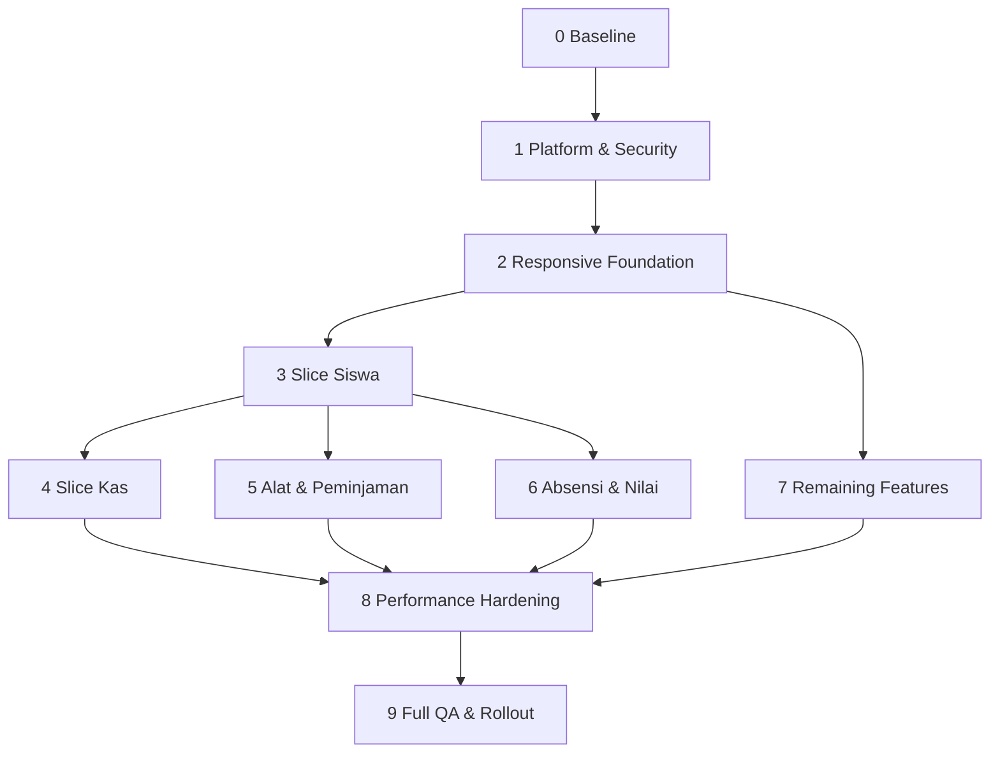

# 07 — Roadmap Implementasi Bertahap

## Aturan Delivery

- Satu fase hanya dimulai setelah exit criteria fase sebelumnya lulus.
- Satu vertical slice mencakup UI, API, data, security, testing, dan observability yang relevan.
- Jangan membuat branch refactor seluruh aplikasi sekaligus.
- Pertahankan desktop flow sampai adapter baru terbukti parity.
- Gunakan feature flag untuk perubahan shell atau high-risk flow.
- PWA tetap di luar roadmap ini.

## Dependency Map

## Fase 0 — Baseline dan Decision Freeze

### Tujuan

Mendokumentasikan perilaku aktual agar refactor tidak mengubah outcome diam-diam.

### Pekerjaan

1. Inventaris route, role, endpoint, list contract, mutation, dan notification link.
2. Rekam screenshot 320/390/768/1024/1440px untuk semua page.
3. Rekam critical journey per role.
4. Ukur bundle/chunk, Web Vitals, API count, payload, dan slow query.
5. Buat permission matrix sementara dari frontend/backend/PRD dan selesaikan konflik.
6. Tetapkan browser/device support minimum.
7. Catat accounting/borrowing/auth invariants sebagai tests sebelum refactor.
8. Putuskan feature flag mechanism.

### Deliverable

- baseline report;
- role-permission matrix;
- critical journey inventory;
- performance/query baseline;
- ADR list;
- screenshot baseline.

### Exit criteria

- tidak ada flow kritis tanpa expected result;
- konflik role sudah diputuskan;
- ukuran baseline dapat diulang;
- owner menerima scope responsive web app dan PWA deferral.

## Fase 1 — Platform dan Security Foundation

### Tujuan

Menutup risiko lintas fitur sebelum memperluas UI.

### Pekerjaan

1. Standard public error + request ID.
2. CORS allowlist dan security headers.
3. Perbaiki cache route mismatch dan private data policy.
4. Permission/capability middleware tanpa menghapus compatibility guard sebelum tests lengkap.
5. Rancang dan implementasikan secure-cookie auth expand phase.
6. Pastikan password-change route tersedia, tidak loop, dan atomic.
7. Nonaktifkan service worker/plugin PWA dengan cara eksplisit; hapus cache-clearing hack setelah verifikasi.
8. Tambahkan structured request logging dan redaction.

### Exit criteria

- auth positive/negative tests lulus;
- tidak ada redirect loop;
- CORS/cache/error tests lulus;
- protected API menolak role/scope salah;
- PWA lama tidak mengontrol cache web app.

## Fase 2 — Responsive Foundation

### Tujuan

Menyediakan primitive dan shell yang dapat dipakai vertical slice tanpa membuat design system baru berlebihan.

### Pekerjaan

1. Pecah `DashboardLayout`.
2. Buat central navigation policy.
3. Buat mobile top bar, bottom nav, More sheet, safe-area shell.
4. Refactor `PageHeader` untuk stacking dan action priority.
5. Tetapkan responsive hook/adapter boundary.
6. Perbaiki touch target Button/Input/Select/Pagination/row action.
7. Buat skeleton/error/empty/no-results patterns.
8. Buat FilterSheet dan detail/action sheet primitive jika belum tersedia.
9. Lazy-load Classes dan library report/export/chart berat.
10. Atur query defaults per domain, bukan global stale-zero untuk semua data.
11. Buat template inventaris data surface yang mencakup page, tab, report,
    dialog, sheet, nested detail, dan print/export.

### Larangan

- belum membuat generic `ResponsiveDataTable` dengan puluhan props;
- belum mengubah seluruh feature table;
- belum mengaktifkan offline/PWA.

### Exit criteria

- shell bekerja 320–1440px;
- navigation role-aware dan keyboard accessible;
- safe area/virtual keyboard lulus;
- tidak ada desktop regression;
- primitive didokumentasikan dengan contoh nyata.

## Fase 3 — Vertical Slice Siswa

### Tujuan

Membuktikan pola CRUD responsif dengan risiko bisnis sedang.

### Pekerjaan

1. Tambah contract/component tests untuk flow siswa existing.
2. Pisahkan page, composition, query/controller, desktop table, mobile list/card, detail sheet.
3. Pecah form besar menjadi controller/fields/result.
4. Pindahkan filter shareable ke URL.
5. Tambahkan option search bila relasi membutuhkan.
6. Pertahankan provisioning akun atomik.
7. Tambah audit access dari detail.
8. Uji parity desktop/mobile dan role boundaries.
9. Evaluasi apakah pola collection cukup stabil untuk shared abstraction kecil.

### Exit criteria

- seluruh create/edit/status/detail/search/filter/page flow lulus mobile/desktop;
- duplicate account/NIS/username negative cases lulus;
- page berukuran kecil dan ownership jelas;
- abstraction decision dicatat, termasuk keputusan untuk tidak membuatnya.

## Fase 4 — Vertical Slice Uang Kas

### Tujuan

Membuktikan pola responsif pada domain kritis dengan optimistic UI, report, dan export.

### Pekerjaan

Ikuti [05-cash-vertical-slice.md](./05-cash-vertical-slice.md):

1. contract/invariant/concurrency tests;
2. page/composition/component decomposition;
3. adaptive transactions/debts;
4. adaptive report sections untuk siswa menunggak serta rincian masuk/keluar;
5. paid/unpaid/partial form flow;
6. payment method breakdown;
7. structured report;
8. PDF/Excel document export;
9. targeted cache update/invalidation;
10. permission/IDOR/formula-injection tests;
11. query plan and reconciliation validation.

### Exit criteria

- check-and-balance valid;
- mutation tidak perlu refresh manual;
- export bukan screenshot;
- tidak ada report table interaktif versi desktop pada mobile;
- concurrent/duplicate/partial/unpaid cases lulus;
- report 90 hari memenuhi performance budget.

## Fase 5 — Peralatan dan Peminjaman

### Tujuan

Membuktikan image-heavy collection dan multi-step lifecycle.

### Urutan

1. Peralatan list/detail/form/upload.
2. Borrowing create/search selection.
3. Approval/reject.
4. Handover.
5. Return/condition/fine.
6. Lifecycle timeline dan notifications.

### Exit criteria

- tidak ada double booking pada concurrency test;
- status/action parity mobile/desktop;
- gambar tidak merusak performance/layout;
- native alert/confirm tidak tersisa;
- notification link dan recipients benar.

## Fase 6 — Absensi dan Nilai

### Tujuan

Menangani bulk/matrix workflow tanpa memaksanya menjadi mobile cards yang buruk.

### Pekerjaan

- Absensi: date-first mobile workspace, quick mark, summary, bulk review.
- Nilai: assignment-first mobile flow, matrix desktop, bulk grading route/workspace.
- Server-search assignment/student options.
- Atomicity/partial failure policy untuk bulk mutation.
- Sticky comparison affordance untuk matrix.

### Exit criteria

- bulk outcome eksplisit;
- matrix tetap usable dengan keyboard/tablet;
- mobile task dapat diselesaikan tanpa tabel penuh;
- duplicate/stale/unauthorized cases lulus.

## Fase 7 — Remaining Features

Urutan risiko:

1. Kelas.
2. Notifikasi.
3. Lomba.
4. Pengguna.
5. Audit.
6. Dashboard refinements.

Pengguna dan Audit ditempatkan belakangan bukan karena tidak penting, tetapi karena membutuhkan permission/error/session foundation yang sudah stabil.

### Exit criteria

- seluruh route memiliki adaptive presentation;
- raw enum/database naming tidak tampil;
- growing lists memakai pagination/projection;
- audit detail tidak membocorkan sensitive values;
- user management negative security tests lulus.

## Fase 8 — Performance Hardening

### Pekerjaan

1. Bandingkan Web Vitals dan bundle terhadap Fase 0.
2. Hilangkan duplicate requests dan over-invalidation.
3. Dynamic import report/chart/export.
4. Image sizing/lazy loading.
5. Profil render list dan context rerender.
6. Audit query plan/payload pada endpoint utama.
7. Tambahkan index hanya berdasarkan evidence.
8. Uji throttled 4G, CPU slowdown, dan mid-range mobile.

### Exit criteria

- tidak ada regression di luar budget/ADR;
- endpoint utama memenuhi SLO yang ditetapkan baseline;
- tidak ada N+1 atau unbounded list;
- query/index report memiliki before/after evidence.

## Fase 9 — Full QA, Accessibility, dan Rollout

### Pekerjaan

1. Full role × feature regression.
2. Browser/viewport/zoom/orientation matrix.
3. Accessibility automated + manual.
4. Visual regression dan fresh-eyes review.
5. Web/API security testing.
6. Data reconciliation dan migration verification.
7. Feature-flag rollout per role.
8. Monitor errors, latency, Web Vitals, auth, duplicate outcomes.
9. Retire legacy adapters setelah observation window.

### Exit criteria

- Definition of Done pada dokumen rollout terpenuhi;
- rollback rehearsal berhasil;
- support/runbook tersedia;
- owner menerima desktop dan mobile flow.

## File-Level Sequence Awal

Urutan implementasi yang meminimalkan konflik:

1. `frontend/src/shared/navigation/*`
2. `frontend/src/layouts/DashboardLayout.tsx` → split components
3. shared layout/feedback primitives
4. auth client/store compatibility migration
5. backend shared plugins/error/auth/cors/cache
6. Students feature files
7. Cash feature files
8. domain backend modules mengikuti slice
9. remaining feature adapters
10. test/observability/cleanup

## Estimasi Relatif

Gunakan unit relatif, bukan tanggal sebelum baseline selesai.

| Fase | Ukuran relatif | Risiko |
|---|---:|---|
| 0 Baseline | M | sedang |
| 1 Platform/security | L | tinggi |
| 2 Responsive foundation | L | sedang |
| 3 Siswa | M | sedang |
| 4 Kas | XL | kritis |
| 5 Alat/peminjaman | XL | kritis |
| 6 Absensi/nilai | XL | tinggi |
| 7 Remaining | XL | sedang–tinggi |
| 8 Performance | M–L | sedang |
| 9 QA/rollout | L | tinggi |

## Checkpoint Review Setiap Fase

Pada akhir fase, laporkan:

- outcome pengguna yang berubah;
- file/module ownership baru;
- API/schema/migration yang berubah;
- tests yang ditambah dan hasilnya;
- performance before/after;
- security findings;
- known limitations;
- rollout/rollback decision;
- izin eksplisit sebelum masuk fase high-risk berikutnya.
