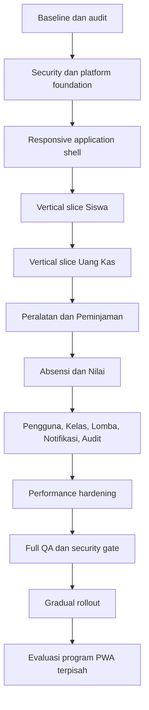

# Program Responsive Web App Sinegasi CMS

## Status

- Dokumen: rencana implementasi dan catatan eksekusi.
- Mode aplikasi: responsive web app, online-first.
- PWA: ditunda ke program terpisah setelah web app stabil.
- Implementasi saat ini: fondasi shell, mobile reachability contract, adapter
  collection Cash, mobile action sheet, compact report filter, single-scroll cash
  form, server-search student options, responsive page actions, dan dashboard
  card-density contract sudah diterapkan. QA visual/browser,
  pengukuran hit-area, dan verifikasi scroll tetap menjadi gate berikutnya.
- Database migration: tidak diperlukan hanya untuk mengubah presentasi responsif.

## Tujuan

Mengubah Sinegasi CMS menjadi web app yang nyaman digunakan melalui browser ponsel, tablet, dan desktop tanpa:

- mengecilkan tabel desktop secara paksa;
- menggandakan business logic antara desktop dan mobile;
- melakukan full rewrite;
- mengaktifkan offline mutation sebelum strategi sinkronisasi tersedia;
- menambah abstraksi generik sebelum pola nyata terbukti;
- mengorbankan keamanan, audit trail, idempotency, atau konsistensi data.

## Keputusan Utama

1. React, Vite, Tailwind, shadcn, TanStack Query, Zustand, React Hook Form, dan Zod tetap digunakan.
2. Aplikasi tetap satu frontend dan satu backend Fastify; tidak ada microservice atau mobile BFF pada fase ini.
3. Desktop menggunakan tabel ketika perbandingan antarkolom penting.
4. Ponsel menggunakan card/list ringkas dan detail sheet atau full-screen task.
5. Query, mutation, schema, service, dan domain type tetap satu sumber untuk semua viewport.
6. Backend tetap menjadi sumber otorisasi dan kebenaran data.
7. Responsivitas tidak boleh memicu migration database tanpa bukti query atau access pattern.
8. PWA, service worker, installability, push, dan offline write ditangani setelah program ini selesai.

## Urutan Dokumen

Dokumen dibaca dan dijalankan sesuai urutan berikut.

1. [Audit kondisi saat ini](./01-current-state-audit.md)
2. [Arsitektur target dan ownership](./02-target-architecture.md)
3. [UX responsif dan alur navigasi](./03-responsive-ux-flows.md)
4. [Peta migrasi seluruh fitur](./04-feature-migration-map.md)
5. [Vertical slice Uang Kas](./05-cash-vertical-slice.md)
6. [Backend, API, data, performa, dan keamanan](./06-backend-data-security-performance.md)
7. [Roadmap implementasi bertahap](./07-implementation-roadmap.md)
8. [Strategi QA dan matriks pengujian](./08-qa-test-matrix.md)
9. [Rollout, observability, rollback, dan Definition of Done](./09-rollout-and-definition-of-done.md)
10. [Mobile reachability dan control specification](./10-mobile-reachability-and-control-spec.md)
11. [Responsive actions dan card density](./11-responsive-actions-and-card-density.md)

## Hubungan dengan Source of Truth

Prioritas aturan tetap:

1. `frontend/docs/engineering-constitution/`
2. `frontend/docs/playbook/`
3. Paket rencana ini
4. Preferensi implementasi lokal

Jika rencana ini bertentangan dengan Engineering Constitution, Constitution yang berlaku dan keputusan penyimpangan wajib ditulis dalam ADR.

## Scope

### Termasuk

- responsive application shell;
- role-aware navigation;
- adaptive collection untuk tabel dan list;
- adaptive collection untuk seluruh data surface, termasuk collection bersarang
  di tab, report, dialog, sheet, dan widget;
- form, dialog, sheet, filter, pagination, dan detail mobile;
- pemecahan page/component besar sesuai ownership;
- konsistensi query dan mutation;
- API projection, pagination, pencarian, dan cache policy;
- authentication hardening;
- accessibility dan touch ergonomics;
- unit, integration, E2E, responsive, visual, performance, dan security testing;
- gradual rollout dan rollback.

### Tidak termasuk

- native iOS/Android;
- React Native atau Flutter;
- offline create/update/delete;
- background sync;
- push notification native;
- service worker caching;
- install prompt;
- perubahan branding besar;
- microservice decomposition;
- migration database yang tidak didukung hasil pengukuran.

## Alur Program



## Alur Data yang Dipertahankan

```text
Route
  → Page tipis
  → Composition
  → Query / Mutation
  → Feature Service
  → Shared HTTP Client
  → Fastify Route
  → Domain Service / Repository seam
  → Supabase PostgreSQL
```

Adapter desktop dan mobile hanya berada pada lapisan presentasi:

```text
Server state yang sama
  → Feature Collection
      ├── Desktop Table Adapter
      ├── Tablet Compact Adapter
      └── Mobile Card/List Adapter
```

## Quality Gates Antar-Fase

Suatu fase tidak boleh dilanjutkan jika gate sebelumnya gagal.

| Gate | Syarat minimum |
|---|---|
| Arsitektur | ownership, interface, data flow, dan dependency direction disetujui |
| Correctness | flow lama tetap bekerja dan test regresi lulus |
| Responsive | tidak ada overflow tidak disengaja pada 320–1440px |
| Accessibility | keyboard, focus, label, touch target, dan contrast memenuhi standar |
| Security | auth, RBAC, IDOR, CORS, XSS, CSRF/session, dan error leakage diperiksa |
| Performance | bundle, request count, payload, render, dan query dibandingkan baseline |
| Data | ledger, audit, idempotency, dan constraint tetap konsisten |
| Rollout | feature flag atau rollback frontend tersedia |

## Aturan Eksekusi

- Kerjakan satu vertical slice hingga selesai sebelum menyalin pola ke fitur lain.
- Siswa menjadi slice CRUD pertama; Uang Kas menjadi slice high-risk kedua.
- Jangan membuat shared abstraction sebelum minimal dua feature adapter membuktikan interface yang sama.
- Jangan mengubah API contract tanpa compatibility plan.
- Jangan mengubah migration lama yang sudah pernah dijalankan; tambahkan migration baru jika benar-benar diperlukan.
- Jangan menyatakan selesai hanya karena build berhasil; verifikasi rendered UI dan interaction trace wajib.
- Jangan menyatakan satu halaman mobile-ready hanya karena tabel utamanya sudah
  memakai card. Inventarisasi setiap `<Table>`/collection pada seluruh tab dan
  report, lalu klasifikasikan sebagai adaptive, matrix exception, atau print-only.
- Jangan menyatakan kontrol mobile-ready hanya karena terlihat pada viewport
  kecil. Ukur hit-area, jangkauan satu tangan, lebar field, safe-area, keyboard,
  dan scroll ownership mengikuti dokumen 10.
